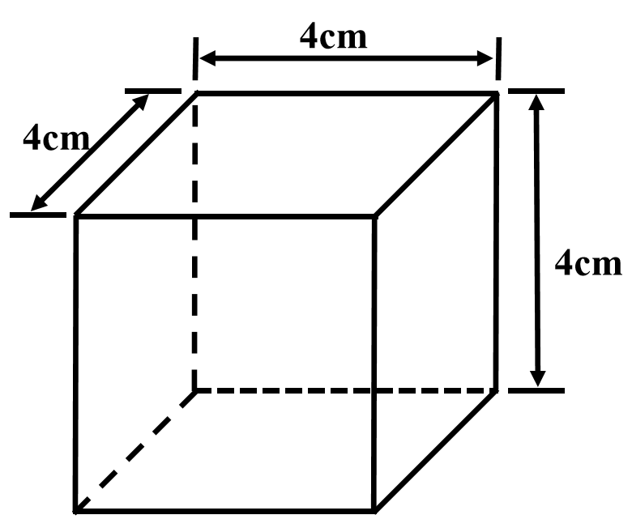
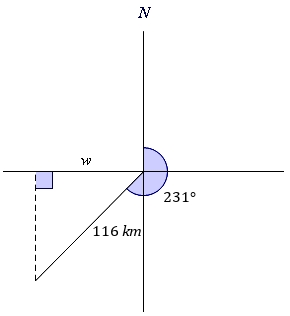

# AVP1138 — Single visual target

We-Math:448 / MathVerse:345 · different type · Geometric markers

## Shared or similar visual information

A vertical dashed line.

## Evidence locations

- Left image: The dashed vertical segment beside the left slanted rear edge.
- Right image: The vertical dashed projection below the left portion of the horizontal line.

## Mathematical meanings

Left image: The line depicts the cube's hidden vertical edge. Right image: The line represents the vertical component from the lower point up to the horizontal reference.

## Same mathematical meanings

no

## Rationales

In the left image, the dashed vertical segment depicts an occluded edge of a solid. In the right image, a vertical auxiliary segment marks a perpendicular height relative to a geometric base.

Only the selected target is annotated. AI visual-review draft; not independently double-annotated by humans.
