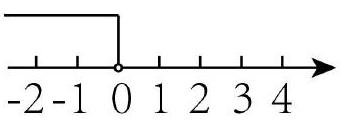

# AVP1140 — Single visual target

MV-MATH:347_1 / MathVerse:602 · different type · Domain and solution-set constraints

## Shared or similar visual information

Circular markers at boundaries of marked spans or plotted branches. Compare the marker at 0 on the number line in the left image with the upper marker at x = −1 in the right image.

## Evidence locations

- Left image: The hollow dot at 0 beneath the right end of the raised trace.
- Right image: The filled dot at (−1, 5), where the declining branch starts.

## Mathematical meanings

Left image: The interval at the left of 0 excludes 0. Right image: The declining branch supplies the included point (−1, 5).

## Same mathematical meanings

no

## Rationales

The selected left cue excludes the indicated boundary point. The selected right cue includes the indicated boundary point, so the two constraints differ in how they admit values.

## Reasoning consequence

In the left image, adding 0 would replace x < 0 with x ≤ 0. In the right image, dropping that dot would wrongly leave x = −1 without its depicted output 5.

Only the selected target is annotated. AI visual-review draft; not independently double-annotated by humans.
