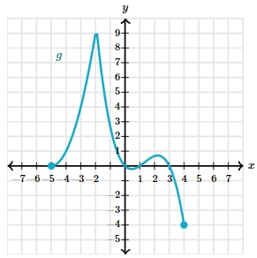
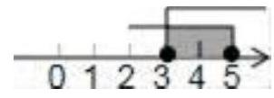

# AVP1141 — Single visual target

MathVerse:559 / MV-MATH:226_2 · different type · Domain and solution-set constraints

## Shared or similar visual information

Circular markers at boundaries of marked spans or plotted branches. Compare the marker at (−5, 0) in the left image with the circular marker at 3 beside the gray region in the right image.

## Evidence locations

- Left image: The filled blue dot at (−5, 0) at the left end of the graph of g.
- Right image: The filled dot at 3 on the left edge of the gray overlap.

## Mathematical meanings

Left image: The left endpoint (−5, 0) belongs to the function's graph. Right image: The highlighted intersection includes its left endpoint 3.

## Same mathematical meanings

yes

## Rationales

The selected cue in each image includes the indicated boundary point. This gives the same local constraint rule in the two contexts.

## Reasoning consequence

In the left image, opening that endpoint would wrongly remove the leftmost zero shown. In the right image, excluding 3 would omit an allowed value from the intersection.

Only the selected target is annotated. AI visual-review draft; not independently double-annotated by humans.
