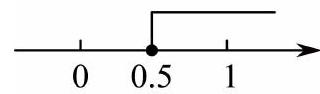

# AVP1142 — Single visual target

MathVerse:482 / MV-MATH:342_3 · different type · Domain and solution-set constraints

## Shared or similar visual information

Circular markers at boundaries of marked spans or plotted branches. Compare the marker at (2, 8) in the left image with the marker at 0.5 on the number line in the right image.

## Evidence locations

- Left image: The hollow circle at (2, 8) at the left end of the blue descending segment.
- Right image: The filled dot at 0.5 under the start of the rightward raised line.

## Mathematical meanings

Left image: The plotted segment excludes its left endpoint (2, 8). Right image: The interval includes the lower boundary 0.5.

## Same mathematical meanings

no

## Rationales

The selected left cue excludes the indicated boundary point. The selected right cue includes the indicated boundary point, so the two constraints differ in how they admit values.

## Reasoning consequence

In the left image, closing the endpoint would falsely assign the depicted function the value 8 at x = 2. In the right image, omitting 0.5 would remove the smallest value in the indicated ray.

Only the selected target is annotated. AI visual-review draft; not independently double-annotated by humans.
