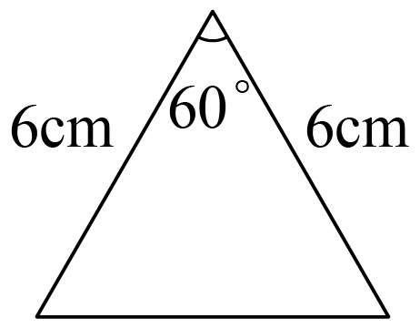
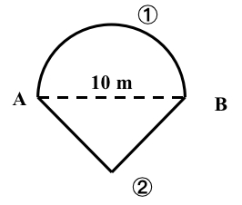

# AVP1143 — Single visual target

We-Math:175 / We-Math:1385 · same type · Geometric markers

## Shared or similar visual information

A circular arc.

## Evidence locations

- Left image: The short arc at the triangle apex above 60 degrees.
- Right image: The curved boundary above the dashed segment labeled 10 m.

## Mathematical meanings

Left image: The arc marks the angle of 60 degrees between the two sides labeled 6 cm. Right image: The arc is the outer semicircular boundary of region 1.

## Same mathematical meanings

no

## Rationales

In the left image, the arc is drawn inside a vertex angle to show which angle is selected. In the right image, the arc forms a part of the boundary of a geometric figure.

Only the selected target is annotated. AI visual-review draft; not independently double-annotated by humans.
