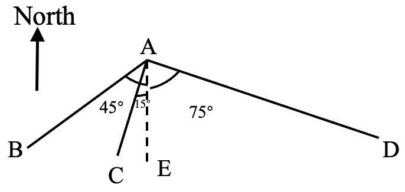
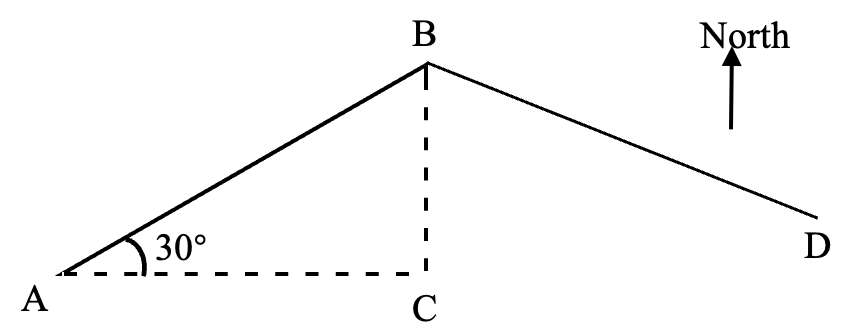

# AVP1144 — Single visual target

We-Math:1562 / We-Math:1407 · same type · Geometric markers

## Shared or similar visual information

An upward arrow on a straight vertical line.

## Evidence locations

- Left image: The upward arrow under North at the upper left of the diagram.
- Right image: The arrow under North near the right side.

## Mathematical meanings

Left image: The arrow gives the north reference of the construction. Right image: The arrow sets the reference direction for north.

## Same mathematical meanings

yes

## Rationales

Both images use the mark in the same way: the arrow sets the compass-north reference for the geometry.

Only the selected target is annotated. AI visual-review draft; not independently double-annotated by humans.
