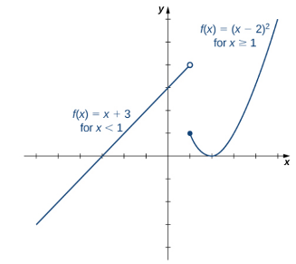
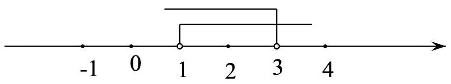

# AVP1145 — Single visual target

MathVista:156 / MV-MATH:346_1 · different type · Domain and solution-set constraints

## Shared or similar visual information

Circular markers at boundaries of marked spans or plotted branches. Compare the lower marker at x = 1 in the left image with the marker at 3 on the number line in the right image.

## Evidence locations

- Left image: The filled blue dot at x = 1 at the start of the parabolic branch.
- Right image: The hollow dot at 3 below the termination of the upper leftward trace.

## Mathematical meanings

Left image: The parabolic branch supplies the included point at x = 1. Right image: The upper trace excludes the right boundary 3.

## Same mathematical meanings

no

## Rationales

The selected left cue includes the indicated boundary point. The selected right cue excludes the indicated boundary point, so the two constraints differ in how they admit values.

## Reasoning consequence

In the left image, dropping that point would remove the value 1 assigned by the shown function at x = 1. In the right image, allowing 3 in the upper trace would also admit it to its overlap with the other trace.

Only the selected target is annotated. AI visual-review draft; not independently double-annotated by humans.
