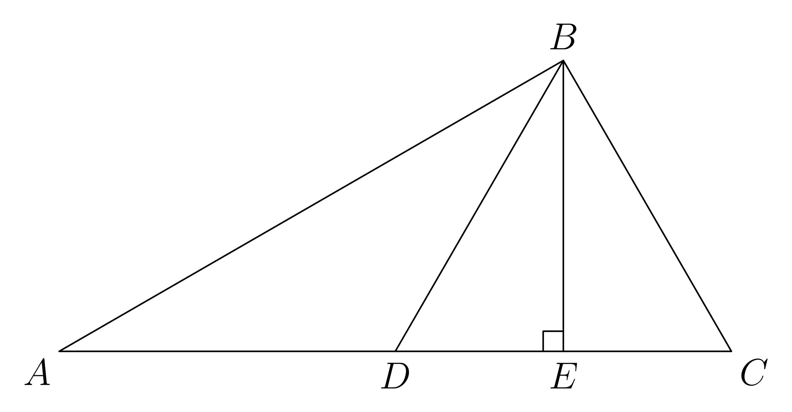

# AVP1146 — Single visual target

MathVision:2944 / MathVision:2099 · same type · Geometric markers

## Shared or similar visual information

A right-angle square.

## Evidence locations

- Left image: The square at E where BE drops to AC.
- Right image: The square at G beside segment GO.

## Mathematical meanings

Left image: BE is perpendicular to AC. Right image: GO meets the segment XY at 90 degrees.

## Same mathematical meanings

yes

## Rationales

Both images use the mark in the same way: a square placed in the angle between two segments marks those segments as perpendicular.

Only the selected target is annotated. AI visual-review draft; not independently double-annotated by humans.
