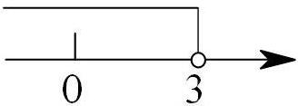

# AVP1146 — Single visual target

MathVerse:485 / MV-MATH:182_1 · different type · Domain and solution-set constraints

## Shared or similar visual information

The direction of a marked trace on a number line or function graph. Compare the arrow on the blue graph trace in the left image with the raised trace attached to the number-line mark at 3 in the right image.

## Evidence locations

- Left image: The arrow at the left end of the blue curve, pointing up and left from the graph's right endpoint.
- Right image: The raised horizontal trace extending left away from the boundary at 3.

## Mathematical meanings

Left image: The depicted graph continues toward inputs smaller than the right endpoint x = 1. Right image: The marked ray admits values smaller than 3.

## Same mathematical meanings

yes

## Rationales

The selected cue in each image selects values on the smaller-input side of the boundary. This gives the same local constraint rule in the two contexts.

## Reasoning consequence

In the left image, reading the branch as continuing right would wrongly extend its domain beyond x = 1. In the right image, reversing its direction would choose values greater than 3 instead.

Only the selected target is annotated. AI visual-review draft; not independently double-annotated by humans.
