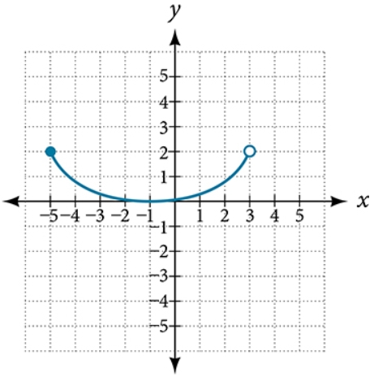
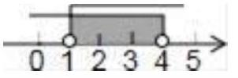

# AVP1148 — Single visual target

MathVerse:484 / MV-MATH:226_3 · different type · Domain and solution-set constraints

## Shared or similar visual information

Circular markers at boundaries of marked spans or plotted branches. Compare the marker at (−5, 2) in the left image with the circular marker at 4 beside the gray region in the right image.

## Evidence locations

- Left image: The filled blue dot at (−5, 2) at the left end of the curve.
- Right image: The hollow dot at 4 on the right edge of the gray overlap.

## Mathematical meanings

Left image: The plotted branch includes (−5, 2) at its left endpoint. Right image: The highlighted intersection excludes 4, its right endpoint.

## Same mathematical meanings

no

## Rationales

The selected left cue includes the indicated boundary point. The selected right cue excludes the indicated boundary point, so the two constraints differ in how they admit values.

## Reasoning consequence

In the left image, opening the endpoint would falsely remove x = −5 and its defined value. In the right image, including 4 would incorrectly close the upper end of the shaded interval.

Only the selected target is annotated. AI visual-review draft; not independently double-annotated by humans.
