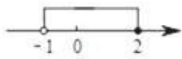

# AVP1149 — Single visual target

MathVerse:484 / MV-MATH:289_1 · different type · Domain and solution-set constraints

## Shared or similar visual information

Circular markers at boundaries of marked spans or plotted branches. Compare the marker at (3, 2) in the left image with the marker at −1 on the number line in the right image.

## Evidence locations

- Left image: The hollow circle at (3, 2) at the right end of the curve.
- Right image: The hollow dot at −1 under the left edge of the raised span.

## Mathematical meanings

Left image: The plotted branch excludes the right endpoint (3, 2). Right image: The marked interval excludes its left endpoint −1.

## Same mathematical meanings

yes

## Rationales

The selected cue in each image excludes the indicated boundary point. This gives the same local constraint rule in the two contexts.

## Reasoning consequence

In the left image, closing the endpoint would incorrectly add x = 3 to the plotted domain. In the right image, including −1 would replace (−1, 2] with [−1, 2].

Only the selected target is annotated. AI visual-review draft; not independently double-annotated by humans.
