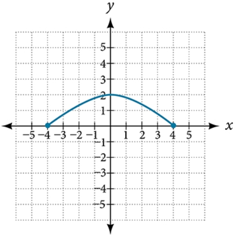
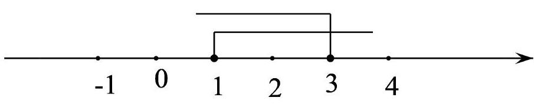

# AVP1150 — Single visual target

MathVerse:483 / MV-MATH:346_3 · different type · Domain and solution-set constraints

## Shared or similar visual information

Circular markers at boundaries of marked spans or plotted branches. Compare the marker at (4, 0) in the left image with the marker at 3 on the number line in the right image.

## Evidence locations

- Left image: The filled dot at (4, 0) at the right end of the blue arc.
- Right image: The filled dot at 3 below the termination of the upper leftward trace.

## Mathematical meanings

Left image: The plotted arc includes its right endpoint (4, 0). Right image: The upper trace includes the right boundary 3.

## Same mathematical meanings

yes

## Rationales

The selected cue in each image includes the indicated boundary point. This gives the same local constraint rule in the two contexts.

## Reasoning consequence

In the left image, omitting the endpoint would lose the rightmost plotted zero of the function. In the right image, dropping 3 would also remove it from the shared overlap.

Only the selected target is annotated. AI visual-review draft; not independently double-annotated by humans.
