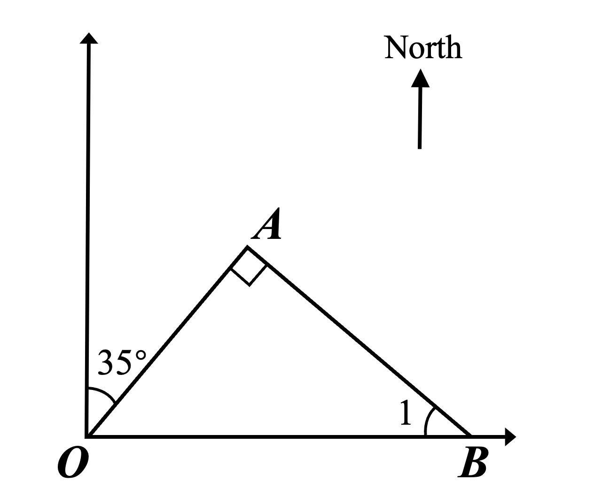
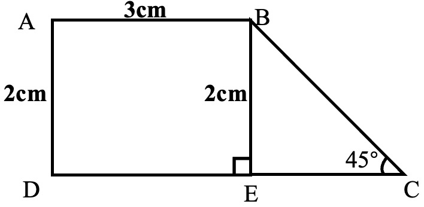

# AVP1151 — Single visual target

We-Math:229 / We-Math:1271 · same type · Geometric markers

## Shared or similar visual information

A right-angle square.

## Evidence locations

- Left image: The tilted square at triangle vertex A.
- Right image: The square at E beside the vertical segment BE.

## Mathematical meanings

Left image: OA and AB are perpendicular at A. Right image: BE is perpendicular to DC.

## Same mathematical meanings

yes

## Rationales

Both images use the mark in the same way: a square placed in the angle between two segments marks those segments as perpendicular.

Only the selected target is annotated. AI visual-review draft; not independently double-annotated by humans.
