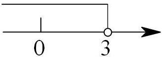

# AVP1152 — Single visual target

MV-MATH:182_1 / MathVerse:475 · same type · Domain and solution-set constraints

## Shared or similar visual information

Circular markers at boundaries of marked spans or plotted branches. Compare the marker at 3 on the number line in the left image with the marker at 4 on the number line in the right image.

## Evidence locations

- Left image: The hollow dot at 3 where the raised trace from the left meets the number line.
- Right image: The filled blue dot at 4 on the highlighted leftward ray.

## Mathematical meanings

Left image: The depicted left-side interval excludes its right endpoint 3. Right image: The ray includes its right endpoint 4.

## Same mathematical meanings

no

## Rationales

The selected left cue excludes the indicated boundary point. The selected right cue includes the indicated boundary point, so the two constraints differ in how they admit values.

## Reasoning consequence

In the left image, adding 3 would turn the right endpoint of the interval from open to closed. In the right image, dropping 4 would turn x ≤ 4 into x < 4.

Only the selected target is annotated. AI visual-review draft; not independently double-annotated by humans.
