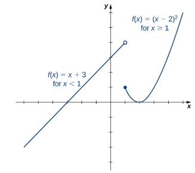
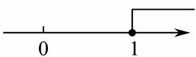

# AVP1153 — Single visual target

MathVista:156 / MV-MATH:342_1 · different type · Domain and solution-set constraints

## Shared or similar visual information

Circular markers at boundaries of marked spans or plotted branches. Compare the lower marker at x = 1 in the left image with the marker at 1 on the number line in the right image.

## Evidence locations

- Left image: The filled blue dot at x = 1 at the start of the parabolic branch.
- Right image: The filled dot at 1 under the start of the rightward raised line.

## Mathematical meanings

Left image: The parabolic branch supplies the included point at x = 1. Right image: The interval includes the lower boundary 1.

## Same mathematical meanings

yes

## Rationales

The selected cue in each image includes the indicated boundary point. This gives the same local constraint rule in the two contexts.

## Reasoning consequence

In the left image, dropping that point would remove the value 1 assigned by the shown function at x = 1. In the right image, dropping 1 would turn x ≥ 1 into x > 1.

Only the selected target is annotated. AI visual-review draft; not independently double-annotated by humans.
