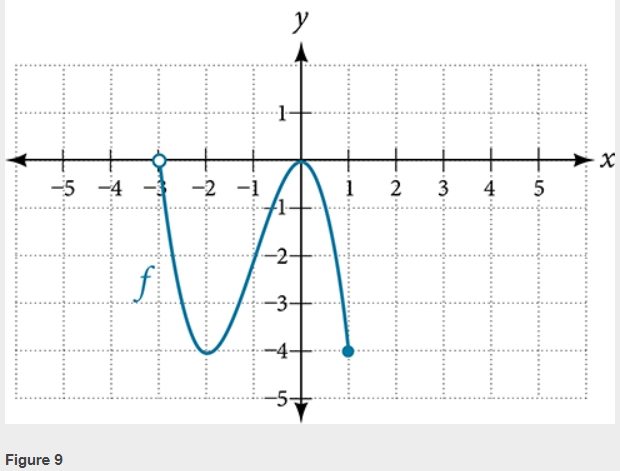
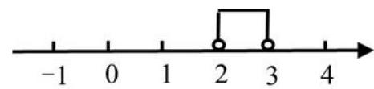

# AVP1154 — Single visual target

MathVerse:481 / MV-MATH:345_4 · different type · Domain and solution-set constraints

## Shared or similar visual information

Circular markers at boundaries of marked spans or plotted branches. Compare the marker at (1, −4) in the left image with the marker at 2 on the number line in the right image.

## Evidence locations

- Left image: The filled blue dot at the bottom-right end of the curve, at (1, −4).
- Right image: The hollow circle at 2 under the left edge of the short raised span.

## Mathematical meanings

Left image: The plotted function includes (1, −4) as its right endpoint. Right image: The interval excludes its left boundary 2.

## Same mathematical meanings

no

## Rationales

The selected left cue includes the indicated boundary point. The selected right cue excludes the indicated boundary point, so the two constraints differ in how they admit values.

## Reasoning consequence

In the left image, treating it as open would wrongly omit x = 1 from the plotted domain. In the right image, including 2 would change (2, 3) to [2, 3).

Only the selected target is annotated. AI visual-review draft; not independently double-annotated by humans.
