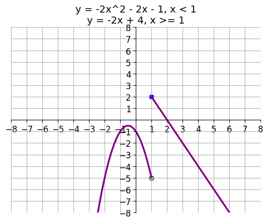

# AVP1155 — Single visual target

MathVista:156 / DynaMath:87 · same type · Domain and solution-set constraints

## Shared or similar visual information

An inequality involving x and a cutoff value beside a piecewise formula. Compare the input condition beside the curved branch in the left image with the input condition in the lower formula label in the right image.

## Evidence locations

- Left image: The x ≥ 1 text directly below the parabola formula f(x) = (x − 2)².
- Right image: The x >= 1 printed after y = −2x + 4 in the lower branch label.

## Mathematical meanings

Left image: The parabolic formula applies for x at least 1, including x = 1. Right image: The linear rule includes x = 1 as its left boundary.

## Same mathematical meanings

yes

## Rationales

The ≥ and >= notations both include equality at x = 1 in the stated formula’s input condition.

## Reasoning consequence

In the left image, interpreting the sign as strict would wrongly remove the assigned value 1 at x = 1. In the right image, reading it as strict would delete the assigned output 2 at the boundary.

Only the selected target is annotated. AI visual-review draft; not independently double-annotated by humans.
