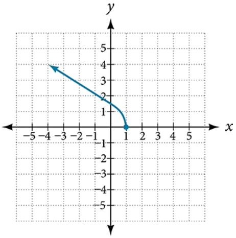

# AVP1156 — Single visual target

MathVerse:485 / MV-MATH:289_4 · different type · Domain and solution-set constraints

## Shared or similar visual information

Circular markers at boundaries of marked spans or plotted branches. Compare the marker at (1, 0) in the left image with the marker at 2 on the number line in the right image.

## Evidence locations

- Left image: The filled blue dot at (1, 0) at the right endpoint.
- Right image: The hollow dot at 2 under the right edge of the raised span.

## Mathematical meanings

Left image: The plot includes the point (1, 0). Right image: The marked interval excludes its right endpoint 2.

## Same mathematical meanings

no

## Rationales

The selected left cue includes the indicated boundary point. The selected right cue excludes the indicated boundary point, so the two constraints differ in how they admit values.

## Reasoning consequence

In the left image, removing that point would wrongly exclude x = 1 and delete the shown zero. In the right image, adding 2 would change the interval (−1, 2) to (−1, 2].

Only the selected target is annotated. AI visual-review draft; not independently double-annotated by humans.
