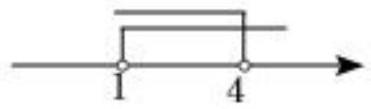
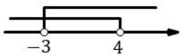

# AVP1157 — Single visual target

MV-MATH:899_4 / MV-MATH:146_3 · same type · Domain and solution-set constraints

## Shared or similar visual information

Two raised interval traces with circular boundary marks on a number line. Compare the traces attached to the marks at 1 and 4 in the left image with the traces attached to the marks at −3 and 4 in the right image.

## Evidence locations

- Left image: The two differently elevated traces with common horizontal coverage between 1 and 4.
- Right image: The two raised traces directed inward from −3 and 4 and overlapping horizontally between them.

## Mathematical meanings

Left image: The strict traces overlap for values between 1 and 4. Right image: The two strict traces share the inputs −3 < x < 4.

## Same mathematical meanings

yes

## Rationales

The selected cue in each image admits the middle interval in both traces. This gives the same local constraint rule in the two contexts.

## Reasoning consequence

In the left image, treating them as disjoint loses common inputs such as 2. In the right image, treating the two traces as outward rays would incorrectly rule out common values such as 0.

Only the selected target is annotated. AI visual-review draft; not independently double-annotated by humans.
