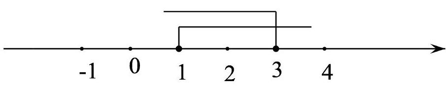
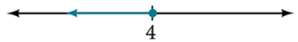

# AVP1158 — Single visual target

MV-MATH:346_3 / MathVerse:475 · same type · Domain and solution-set constraints

## Shared or similar visual information

Circular markers at boundaries of marked spans or plotted branches. Compare the marker at 3 on the number line in the left image with the marker at 4 on the number line in the right image.

## Evidence locations

- Left image: The filled dot at 3 below the termination of the upper leftward trace.
- Right image: The filled blue dot at 4 on the highlighted leftward ray.

## Mathematical meanings

Left image: The upper trace includes the right boundary 3. Right image: The ray includes its right endpoint 4.

## Same mathematical meanings

yes

## Rationales

The selected cue in each image includes the indicated boundary point. This gives the same local constraint rule in the two contexts.

## Reasoning consequence

In the left image, dropping 3 would also remove it from the shared overlap. In the right image, dropping 4 would turn x ≤ 4 into x < 4.

Only the selected target is annotated. AI visual-review draft; not independently double-annotated by humans.
