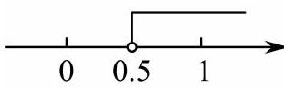
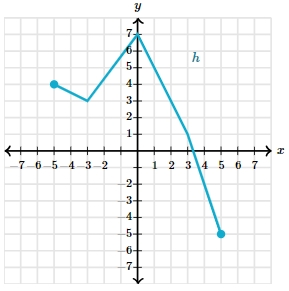

# AVP1159 — Single visual target

MV-MATH:342_4 / MathVerse:558 · different type · Domain and solution-set constraints

## Shared or similar visual information

Circular markers at boundaries of marked spans or plotted branches. Compare the marker at 0.5 on the number line in the left image with the marker at (5, −5) in the right image.

## Evidence locations

- Left image: The hollow dot at 0.5 under the start of the rightward raised line.
- Right image: The filled blue dot at the end of the steep right-hand segment at (5, −5).

## Mathematical meanings

Left image: The interval excludes the lower boundary 0.5. Right image: The right endpoint (5, −5) is included in the graph of h.

## Same mathematical meanings

no

## Rationales

The selected left cue excludes the indicated boundary point. The selected right cue includes the indicated boundary point, so the two constraints differ in how they admit values.

## Reasoning consequence

In the left image, including 0.5 would falsely give the interval a smallest member. In the right image, treating it as a hole would wrongly omit h(5) = −5.

Only the selected target is annotated. AI visual-review draft; not independently double-annotated by humans.
