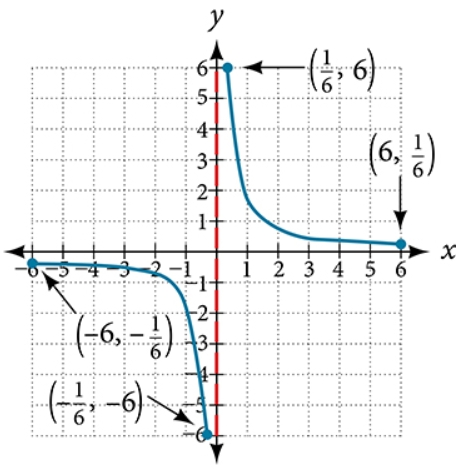
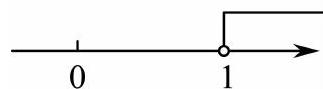

# AVP1160 — Single visual target

MathVerse:486 / MV-MATH:342_2 · different type · Domain and solution-set constraints

## Shared or similar visual information

Circular markers at boundaries of marked spans or plotted branches. Compare the marker at (6, 1/6) in the left image with the marker at 1 on the number line in the right image.

## Evidence locations

- Left image: The filled dot at the label (6, 1/6) on the right-hand branch.
- Right image: The hollow dot at 1 under the start of the rightward raised line.

## Mathematical meanings

Left image: The positive branch includes the labeled right endpoint. Right image: The interval excludes the lower boundary 1.

## Same mathematical meanings

no

## Rationales

The selected left cue includes the indicated boundary point. The selected right cue excludes the indicated boundary point, so the two constraints differ in how they admit values.

## Reasoning consequence

In the left image, reading the point as open would wrongly remove x = 6 from the domain of the shown branch. In the right image, adding 1 would turn x > 1 into x ≥ 1.

Only the selected target is annotated. AI visual-review draft; not independently double-annotated by humans.
