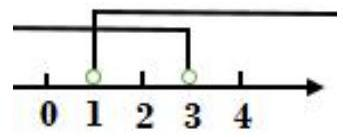
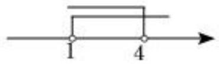

# AVP1161 — Single visual target

MV-MATH:344_4 / MV-MATH:899_4 · same type · Domain and solution-set constraints

## Shared or similar visual information

Two raised interval traces with circular boundary marks on a number line. Compare the traces attached to the marks at 1 and 3 in the left image with the traces attached to the marks at 1 and 4 in the right image.

## Evidence locations

- Left image: The raised traces extending toward each other from 1 and 3, with horizontal overlap between the hollow dots.
- Right image: The two differently elevated traces with common horizontal coverage between 1 and 4.

## Mathematical meanings

Left image: Both inequalities are satisfied for values strictly between 1 and 3. Right image: The strict traces overlap for values between 1 and 4.

## Same mathematical meanings

yes

## Rationales

The selected cue in each image admits the middle interval in both traces. This gives the same local constraint rule in the two contexts.

## Reasoning consequence

In the left image, reading the traces as outward would incorrectly reject the shared value 2. In the right image, treating them as disjoint loses common inputs such as 2.

Only the selected target is annotated. AI visual-review draft; not independently double-annotated by humans.
