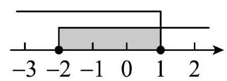
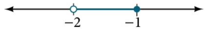

# AVP1164 — Single visual target

MV-MATH:343_2 / MathVerse:474 · same type · Domain and solution-set constraints

## Shared or similar visual information

Circular markers at boundaries of marked spans or plotted branches. Compare the marker at 1 beside the gray region in the left image with the marker at −2 on the number line in the right image.

## Evidence locations

- Left image: The filled dot at 1 at the right side of the shaded region.
- Right image: The hollow blue dot at −2 at the left edge of the blue span.

## Mathematical meanings

Left image: The shaded overlap includes the upper boundary 1. Right image: The highlighted interval excludes its left endpoint −2.

## Same mathematical meanings

no

## Rationales

The selected left cue includes the indicated boundary point. The selected right cue excludes the indicated boundary point, so the two constraints differ in how they admit values.

## Reasoning consequence

In the left image, dropping 1 would misreport the upper end of [−2, 1]. In the right image, adding −2 would give the interval the wrong left bracket.

Only the selected target is annotated. AI visual-review draft; not independently double-annotated by humans.
