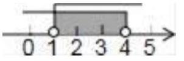
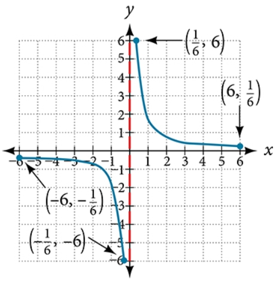

# AVP1165 — Single visual target

MV-MATH:226_3 / MathVerse:486 · different type · Domain and solution-set constraints

## Shared or similar visual information

Circular markers at boundaries of marked spans or plotted branches. Compare the circular marker at 4 beside the gray region in the left image with the marker at (6, 1/6) in the right image.

## Evidence locations

- Left image: The hollow dot at 4 on the right edge of the gray overlap.
- Right image: The filled dot at the label (6, 1/6) on the right-hand branch.

## Mathematical meanings

Left image: The highlighted intersection excludes 4, its right endpoint. Right image: The positive branch includes the labeled right endpoint.

## Same mathematical meanings

no

## Rationales

The selected left cue excludes the indicated boundary point. The selected right cue includes the indicated boundary point, so the two constraints differ in how they admit values.

## Reasoning consequence

In the left image, including 4 would incorrectly close the upper end of the shaded interval. In the right image, reading the point as open would wrongly remove x = 6 from the domain of the shown branch.

Only the selected target is annotated. AI visual-review draft; not independently double-annotated by humans.
