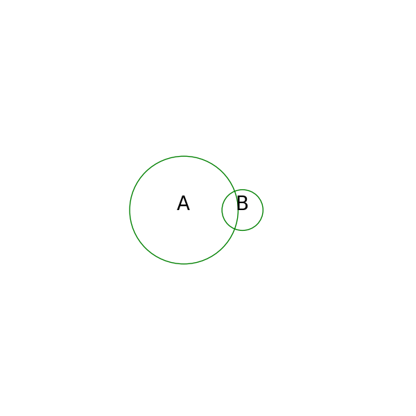
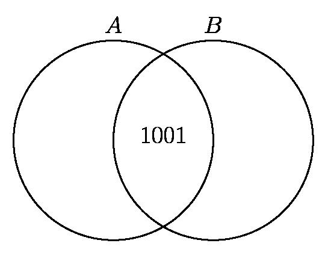

# AVP1166 — Single visual target

DynaMath:121 / MathVision:2682 · same type · Domain and solution-set constraints

## Shared or similar visual information

The lens-shaped region inside both circular outlines. On the left, use the narrow white lens simultaneously inside both green circles. On the right, use the central unshaded lens labeled 1001 inside both the A and B contours.

## Evidence locations

- Left image: The narrow white lens simultaneously inside both green circles.
- Right image: The central unshaded lens labeled 1001 inside both the A and B contours.

## Mathematical meanings

Left image: The lens consists of the elements common to A and B. Right image: The lens contains elements shared by A and B, with cardinality 1001.

## Same mathematical meanings

yes

## Rationales

The selected region lies within both labeled contours in each diagram, which assigns simultaneous membership in the two sets.

## Reasoning consequence

Correctly interpreting the markings means reading the crossing contours as evidence that A and B overlap on the left and subtracting the shared 1001 elements when converting the sum of set sizes to union size on the right.

Only the selected target is annotated. AI visual-review draft; not independently double-annotated by humans.
