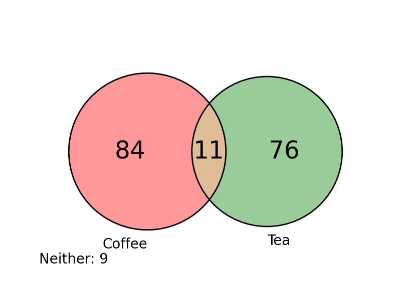
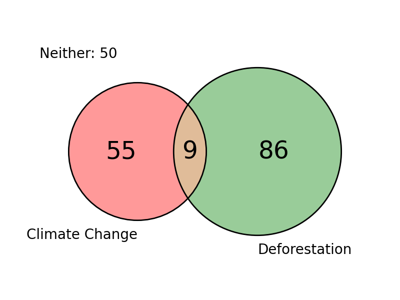

# AVP1167 — Single visual target

DynaMath:464 / DynaMath:466 · same type · Domain and solution-set constraints

## Shared or similar visual information

The lens-shaped region inside both circular outlines. On the left, use the tan lens labeled 11 between Coffee and Tea. On the right, use the tan lens labeled 9 between Climate Change and Deforestation.

## Evidence locations

- Left image: The tan lens labeled 11 between Coffee and Tea.
- Right image: The tan lens labeled 9 between Climate Change and Deforestation.

## Mathematical meanings

Left image: The lens represents respondents who prefer both Coffee and Tea. Right image: The lens represents respondents concerned about both issues.

## Same mathematical meanings

yes

## Rationales

The selected region lies within both labeled contours in each diagram, which assigns simultaneous membership in the two sets.

## Reasoning consequence

Correctly interpreting the markings means using 11 as the count for both beverage preferences on the left and counting the nine shared respondents once when computing the union on the right.

Only the selected target is annotated. AI visual-review draft; not independently double-annotated by humans.
