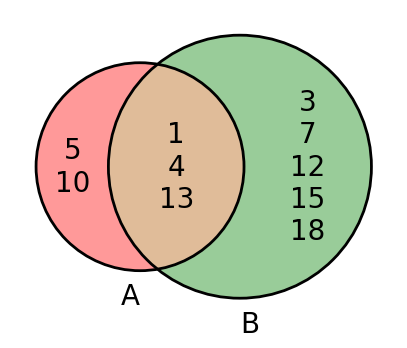
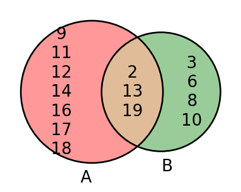

# AVP1169 — Single visual target

DynaMath:468 / DynaMath:469 · same type · Domain and solution-set constraints

## Shared or similar visual information

The lens-shaped region inside both circular outlines. On the left, use the tan lens containing 1, 4 and 13. On the right, use the tan lens containing 2, 13 and 19.

## Evidence locations

- Left image: The tan lens containing 1, 4 and 13.
- Right image: The tan lens containing 2, 13 and 19.

## Mathematical meanings

Left image: The lens lists the elements that belong to both A and B. Right image: The lens lists the elements that belong to both A and B.

## Same mathematical meanings

yes

## Rationales

The selected region lies within both labeled contours in each diagram, which assigns simultaneous membership in the two sets.

## Reasoning consequence

Correctly interpreting the markings means obtaining the intersection {1, 4, 13} on the left and counting 2, 13 and 19 only once each when forming the union on the right.

Only the selected target is annotated. AI visual-review draft; not independently double-annotated by humans.
