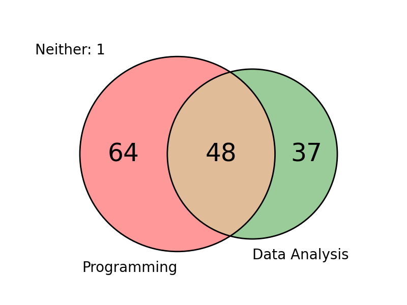
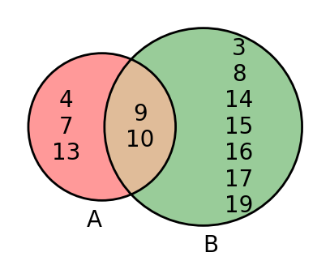

# AVP1171 — Single visual target

DynaMath:471 / DynaMath:473 · same type · Domain and solution-set constraints

## Shared or similar visual information

The lens-shaped region inside both circular outlines. On the left, use the tan lens labeled 48 between Programming and Data Analysis. On the right, use the tan lens containing 9 and 10.

## Evidence locations

- Left image: The tan lens labeled 48 between Programming and Data Analysis.
- Right image: The tan lens containing 9 and 10.

## Mathematical meanings

Left image: The lens represents employees who possess both skills. Right image: The lens lists the elements belonging to both A and B.

## Same mathematical meanings

yes

## Rationales

The selected region lies within both labeled contours in each diagram, which assigns simultaneous membership in the two sets.

## Reasoning consequence

Correctly interpreting the markings means excluding 48 from the count of employees with exactly one of the two skills on the left and excluding 9 and 10 from the answer for B only on the right.

Only the selected target is annotated. AI visual-review draft; not independently double-annotated by humans.
