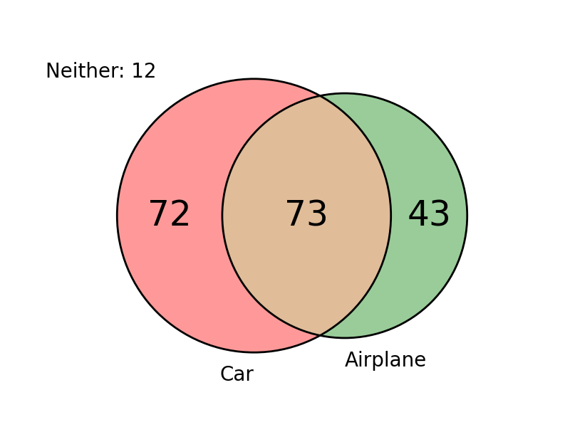
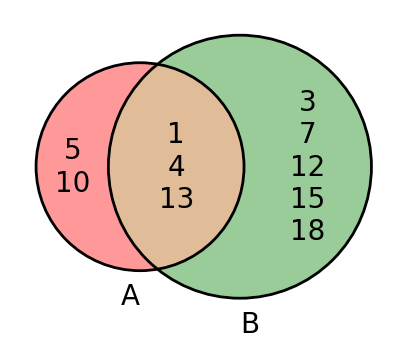

# AVP1172 — Single visual target

DynaMath:472 / DynaMath:468 · same type · Domain and solution-set constraints

## Shared or similar visual information

The lens-shaped region inside both circular outlines. On the left, use the tan lens labeled 73 between Car and Airplane. On the right, use the tan lens containing 1, 4 and 13.

## Evidence locations

- Left image: The tan lens labeled 73 between Car and Airplane.
- Right image: The tan lens containing 1, 4 and 13.

## Mathematical meanings

Left image: The lens represents respondents who like both modes of travel. Right image: The lens lists the elements that belong to both A and B.

## Same mathematical meanings

yes

## Rationales

The selected region lies within both labeled contours in each diagram, which assigns simultaneous membership in the two sets.

## Reasoning consequence

Correctly interpreting the markings means including these 73 respondents in the Airplane set on the left and obtaining the intersection {1, 4, 13} on the right.

Only the selected target is annotated. AI visual-review draft; not independently double-annotated by humans.
