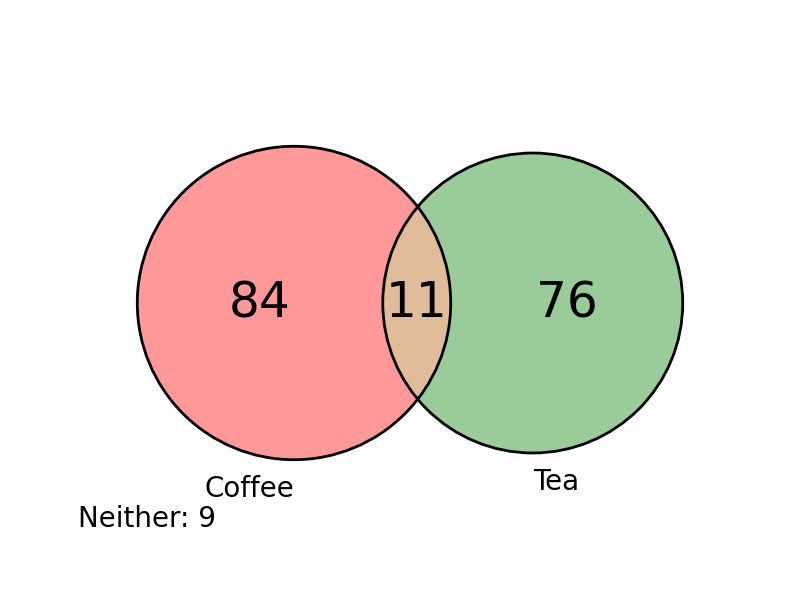
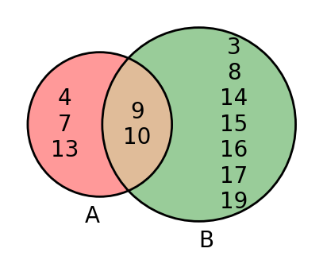

# AVP1173 — Single visual target

DynaMath:464 / DynaMath:473 · same type · Domain and solution-set constraints

## Shared or similar visual information

A colored crescent inside one set circle and outside its overlap with the other. On the left, use the pink Coffee crescent containing 84 and lying outside the Tea circle. On the right, use the green crescent containing 3, 8, 14, 15, 16, 17 and 19.

## Evidence locations

- Left image: The pink Coffee crescent containing 84 and lying outside the Tea circle.
- Right image: The green crescent containing 3, 8, 14, 15, 16, 17 and 19.

## Mathematical meanings

Left image: The region represents people who prefer Coffee and do not prefer Tea. Right image: It lists the elements belonging to B and outside A.

## Same mathematical meanings

yes

## Rationales

The outer contour and intervening overlap boundary pick out members of exactly the selected set in both figures.

## Reasoning consequence

Correctly interpreting the markings means using 84 alone as the Coffee-only count on the left and selecting those seven elements for B only on the right.

Only the selected target is annotated. AI visual-review draft; not independently double-annotated by humans.
