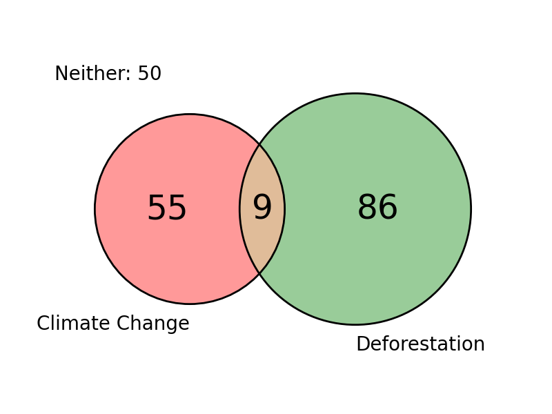
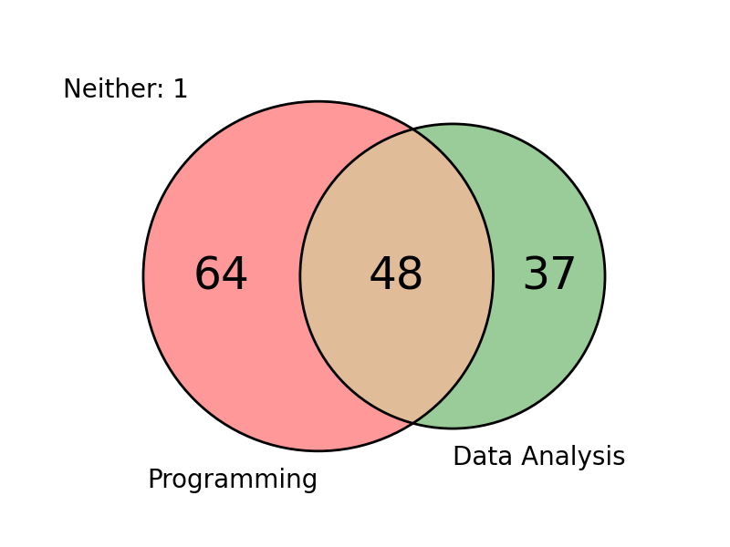

# AVP1175 — Single visual target

DynaMath:466 / DynaMath:471 · same type · Domain and solution-set constraints

## Shared or similar visual information

A colored crescent inside one set circle and outside its overlap with the other. On the left, use the pink Climate Change crescent marked 55, outside the other circle. On the right, use the pink Programming crescent labeled 64, outside the Data Analysis circle.

## Evidence locations

- Left image: The pink Climate Change crescent marked 55, outside the other circle.
- Right image: The pink Programming crescent labeled 64, outside the Data Analysis circle.

## Mathematical meanings

Left image: The region represents respondents concerned about Climate Change only. Right image: It represents employees with Programming only.

## Same mathematical meanings

yes

## Rationales

The outer contour and intervening overlap boundary pick out members of exactly the selected set in both figures.

## Reasoning consequence

Correctly interpreting the markings means treating 55 as a one-concern count on the left and including 64 in the count for exactly one skill on the right.

Only the selected target is annotated. AI visual-review draft; not independently double-annotated by humans.
