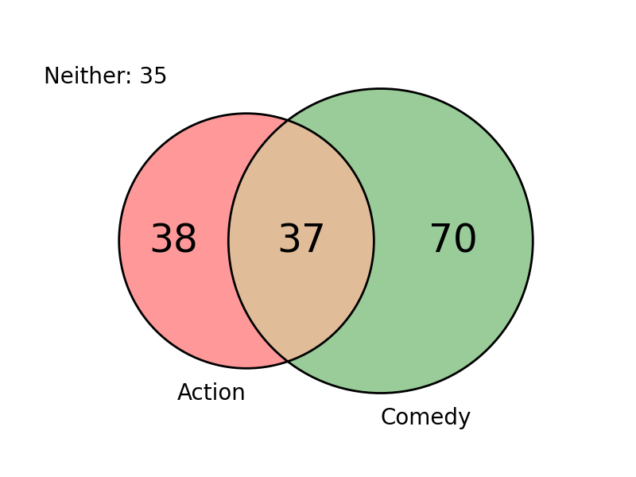
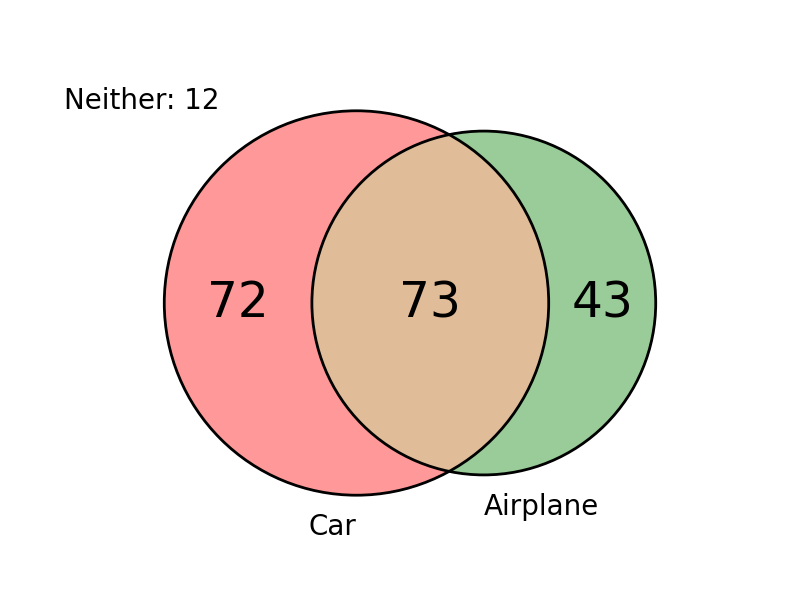

# AVP1176 — Single visual target

DynaMath:467 / DynaMath:472 · same type · Domain and solution-set constraints

## Shared or similar visual information

A colored crescent inside one set circle and outside its overlap with the other. On the left, use the green Comedy crescent marked 70, outside the Action circle. On the right, use the pink Car crescent containing 72 outside the Airplane circle.

## Evidence locations

- Left image: The green Comedy crescent marked 70, outside the Action circle.
- Right image: The pink Car crescent containing 72 outside the Airplane circle.

## Mathematical meanings

Left image: The region represents moviegoers who like Comedy only. Right image: It represents the people in the Car category only.

## Same mathematical meanings

yes

## Rationales

The outer contour and intervening overlap boundary pick out members of exactly the selected set in both figures.

## Reasoning consequence

Correctly interpreting the markings means keeping these 70 people separate from the intersection count on the left and including these 72 people in the count for people outside the Airplane set on the right.

Only the selected target is annotated. AI visual-review draft; not independently double-annotated by humans.
