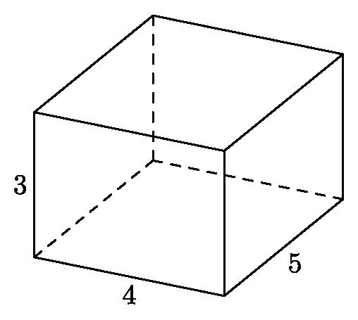
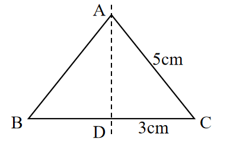

# AVP1178 — Single visual target

MathVision:2206 / We-Math:115 · different type · Geometric markers

## Shared or similar visual information

A vertical dashed line.

## Evidence locations

- Left image: The vertical dashed segment from the rear top corner to the junction of the three dashed edges.
- Right image: The vertical dashed line through A and D.

## Mathematical meanings

Left image: The line depicts the cuboid's hidden rear vertical edge. Right image: The line is the symmetry axis through the apex and the base of the triangle.

## Same mathematical meanings

no

## Rationales

In the left image, the dashed vertical segment depicts an occluded edge of a solid. In the right image, the dashed line is the axis used to reflect a geometric figure.

Only the selected target is annotated. AI visual-review draft; not independently double-annotated by humans.
