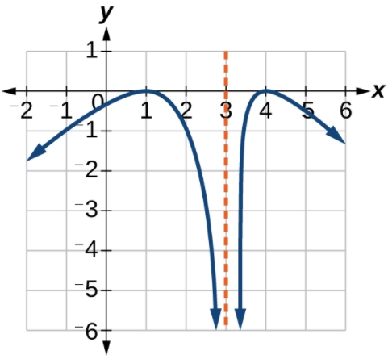
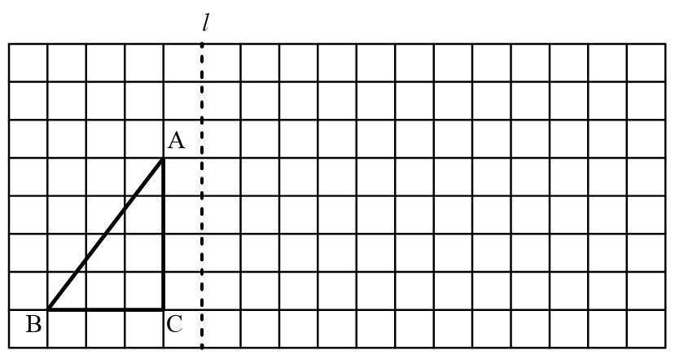

# AVP1179 — Single visual target

MathVerse:489 / We-Math:392 · different type · Geometric markers

## Shared or similar visual information

A vertical dashed line.

## Evidence locations

- Left image: The orange dashed vertical line at x = 3.
- Right image: The vertical dashed line marked l on the grid.

## Mathematical meanings

Left image: The line marks the vertical asymptote at x = 3. Right image: The line is the axis of reflection for triangle ABC.

## Same mathematical meanings

no

## Rationales

In the left image, the dashed line marks a vertical asymptote approached by the curve. In the right image, the dashed line is the axis used to reflect a geometric figure.

Only the selected target is annotated. AI visual-review draft; not independently double-annotated by humans.
