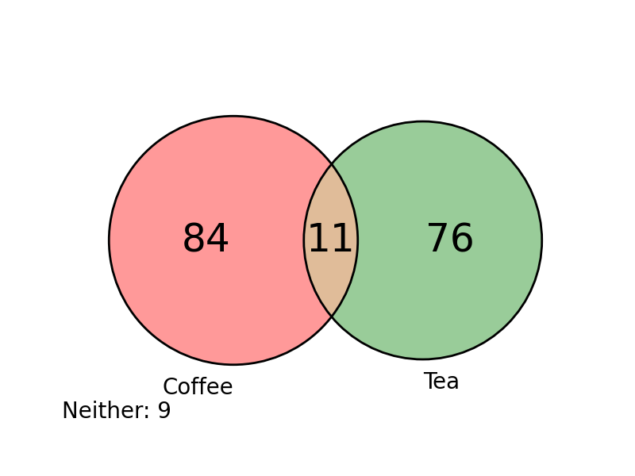
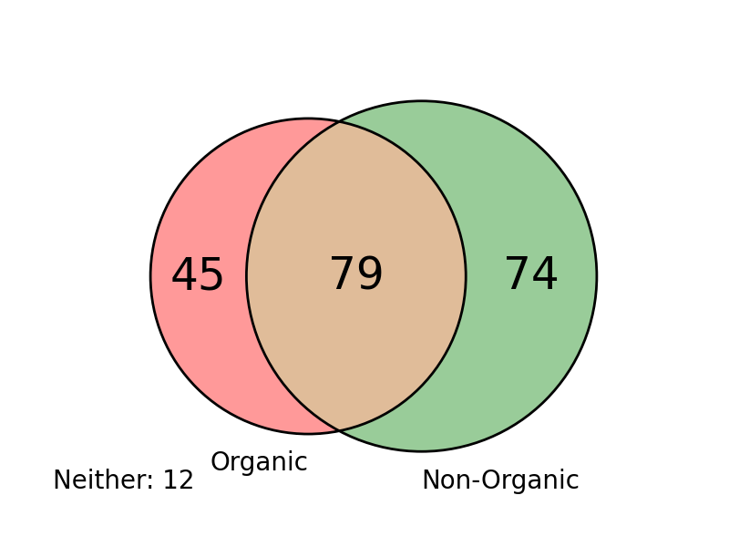

# AVP1180 — Single visual target

DynaMath:464 / DynaMath:465 · same type · Domain and solution-set constraints

## Shared or similar visual information

A colored region delimited by the intersecting contours of two circles. On the left, use the tan lens labeled 11 between Coffee and Tea. On the right, use the green Non-Organic crescent containing 74 outside the Organic circle.

## Evidence locations

- Left image: The tan lens labeled 11 between Coffee and Tea.
- Right image: The green Non-Organic crescent containing 74 outside the Organic circle.

## Mathematical meanings

Left image: The lens represents respondents who prefer both Coffee and Tea. Right image: The region represents customers in the Non-Organic category only.

## Same mathematical meanings

no

## Rationales

The lens is inside both circle boundaries, so it requires both memberships. The crescent lies inside only one circle and excludes the shared members.

## Reasoning consequence

Correctly interpreting the markings means using 11 as the count for both beverage preferences on the left and using 74 alone for the Non-Organic-only count on the right.

Only the selected target is annotated. AI visual-review draft; not independently double-annotated by humans.
