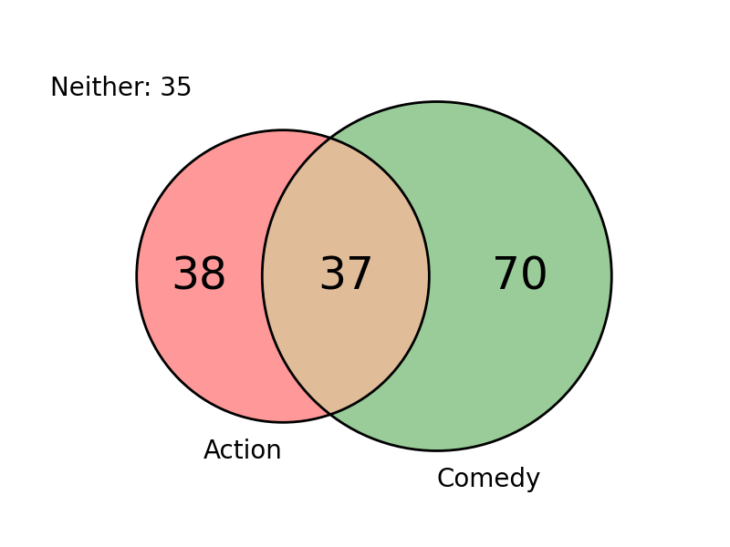
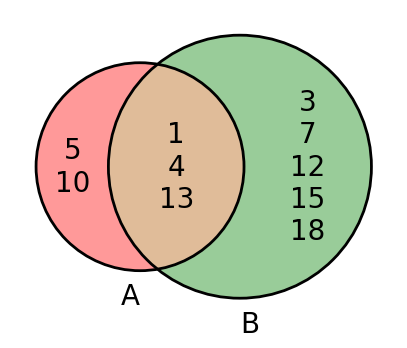

# AVP1181 — Single visual target

DynaMath:467 / DynaMath:468 · same type · Domain and solution-set constraints

## Shared or similar visual information

A colored region delimited by the intersecting contours of two circles. On the left, use the tan lens labeled 37 between the Action and Comedy circles. On the right, use the pink crescent containing 5 and 10 outside circle B.

## Evidence locations

- Left image: The tan lens labeled 37 between the Action and Comedy circles.
- Right image: The pink crescent containing 5 and 10 outside circle B.

## Mathematical meanings

Left image: The lens represents moviegoers who like both genres. Right image: It lists the elements in A only.

## Same mathematical meanings

no

## Rationales

The lens is inside both circle boundaries, so it requires both memberships. The crescent lies inside only one circle and excludes the shared members.

## Reasoning consequence

Correctly interpreting the markings means using 37 for the count of people who like both genres on the left and excluding 5 and 10 when listing the intersection on the right.

Only the selected target is annotated. AI visual-review draft; not independently double-annotated by humans.
