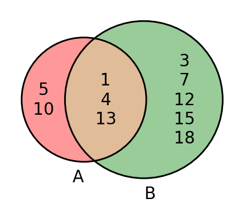
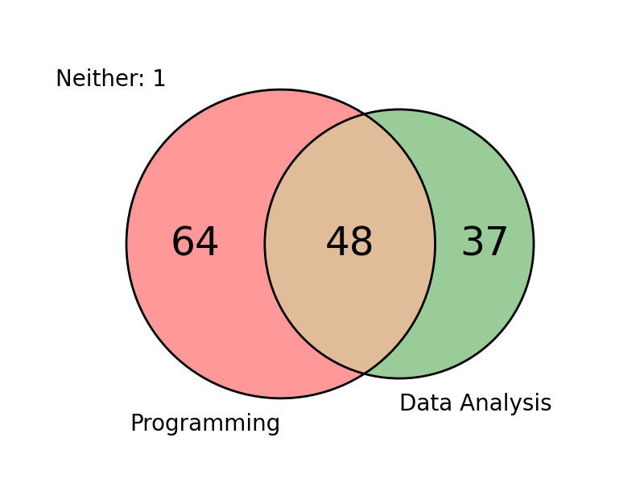

# AVP1182 — Single visual target

DynaMath:468 / DynaMath:471 · same type · Domain and solution-set constraints

## Shared or similar visual information

A colored region delimited by the intersecting contours of two circles. On the left, use the tan lens containing 1, 4 and 13. On the right, use the pink Programming crescent labeled 64, outside the Data Analysis circle.

## Evidence locations

- Left image: The tan lens containing 1, 4 and 13.
- Right image: The pink Programming crescent labeled 64, outside the Data Analysis circle.

## Mathematical meanings

Left image: The lens lists the elements that belong to both A and B. Right image: It represents employees with Programming only.

## Same mathematical meanings

no

## Rationales

The lens is inside both circle boundaries, so it requires both memberships. The crescent lies inside only one circle and excludes the shared members.

## Reasoning consequence

Correctly interpreting the markings means obtaining the intersection {1, 4, 13} on the left and including 64 in the count for exactly one skill on the right.

Only the selected target is annotated. AI visual-review draft; not independently double-annotated by humans.
