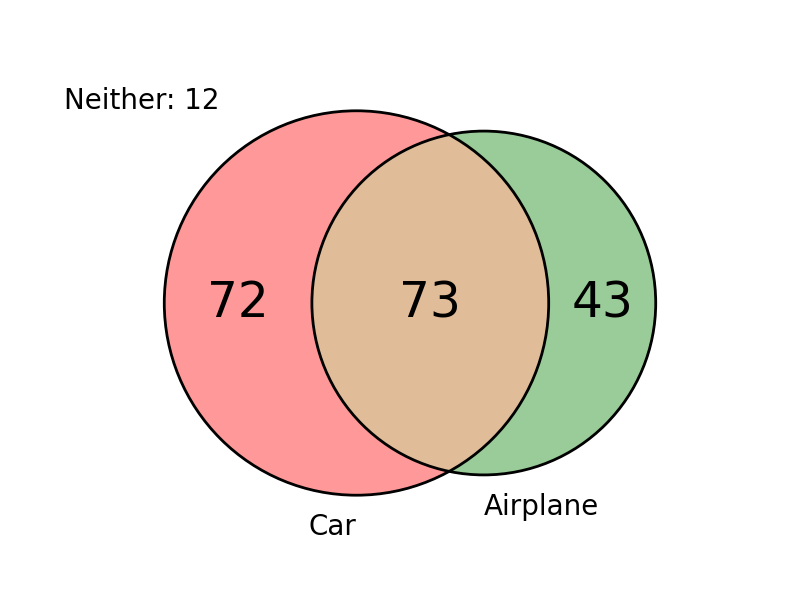

# AVP1184 — Single visual target

DynaMath:470 / DynaMath:472 · same type · Domain and solution-set constraints

## Shared or similar visual information

A colored region delimited by the intersecting contours of two circles. On the left, use the tan lens containing 2, 3, 4, 5 and 11. On the right, use the pink Car crescent containing 72 outside the Airplane circle.

## Evidence locations

- Left image: The tan lens containing 2, 3, 4, 5 and 11.
- Right image: The pink Car crescent containing 72 outside the Airplane circle.

## Mathematical meanings

Left image: The lens lists elements contained in both A and B. Right image: It represents the people in the Car category only.

## Same mathematical meanings

no

## Rationales

The lens is inside both circle boundaries, so it requires both memberships. The crescent lies inside only one circle and excludes the shared members.

## Reasoning consequence

Correctly interpreting the markings means excluding 2, 3, 4, 5 and 11 from the answer for A only on the left and including these 72 people in the count for people outside the Airplane set on the right.

Only the selected target is annotated. AI visual-review draft; not independently double-annotated by humans.
