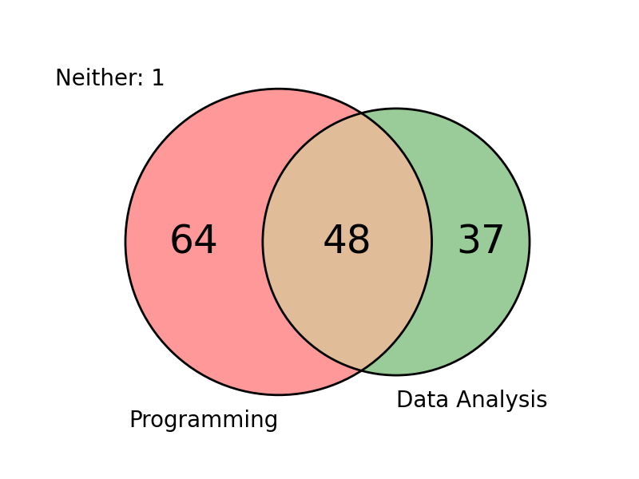
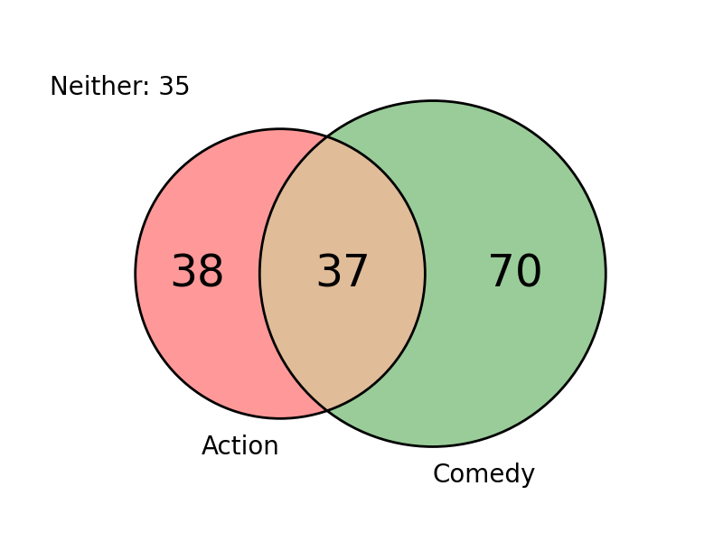

# AVP1185 — Single visual target

DynaMath:471 / DynaMath:467 · same type · Domain and solution-set constraints

## Shared or similar visual information

A colored region delimited by the intersecting contours of two circles. On the left, use the tan lens labeled 48 between Programming and Data Analysis. On the right, use the green Comedy crescent marked 70, outside the Action circle.

## Evidence locations

- Left image: The tan lens labeled 48 between Programming and Data Analysis.
- Right image: The green Comedy crescent marked 70, outside the Action circle.

## Mathematical meanings

Left image: The lens represents employees who possess both skills. Right image: The region represents moviegoers who like Comedy only.

## Same mathematical meanings

no

## Rationales

The lens is inside both circle boundaries, so it requires both memberships. The crescent lies inside only one circle and excludes the shared members.

## Reasoning consequence

Correctly interpreting the markings means excluding 48 from the count of employees with exactly one of the two skills on the left and keeping these 70 people separate from the intersection count on the right.

Only the selected target is annotated. AI visual-review draft; not independently double-annotated by humans.
