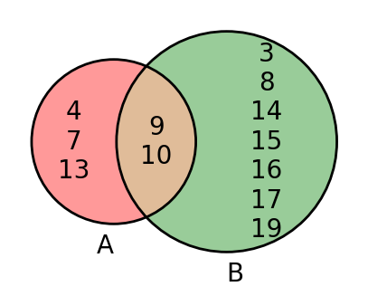
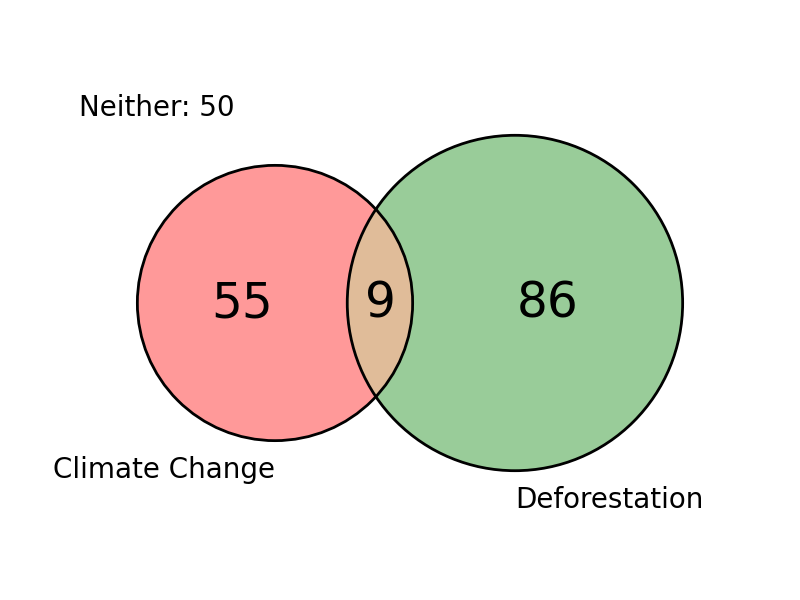

# AVP1186 — Single visual target

DynaMath:473 / DynaMath:466 · same type · Domain and solution-set constraints

## Shared or similar visual information

A colored region delimited by the intersecting contours of two circles. On the left, use the tan lens containing 9 and 10. On the right, use the pink Climate Change crescent marked 55, outside the other circle.

## Evidence locations

- Left image: The tan lens containing 9 and 10.
- Right image: The pink Climate Change crescent marked 55, outside the other circle.

## Mathematical meanings

Left image: The lens lists the elements belonging to both A and B. Right image: The region represents respondents concerned about Climate Change only.

## Same mathematical meanings

no

## Rationales

The lens is inside both circle boundaries, so it requires both memberships. The crescent lies inside only one circle and excludes the shared members.

## Reasoning consequence

Correctly interpreting the markings means excluding 9 and 10 from the answer for B only on the left and treating 55 as a one-concern count on the right.

Only the selected target is annotated. AI visual-review draft; not independently double-annotated by humans.
