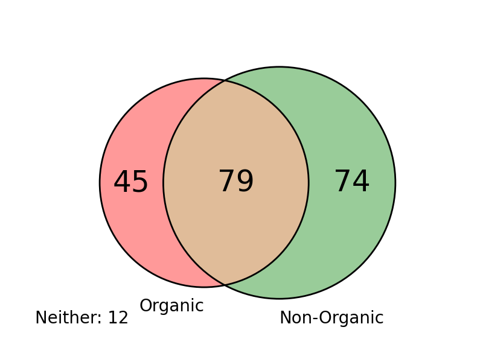
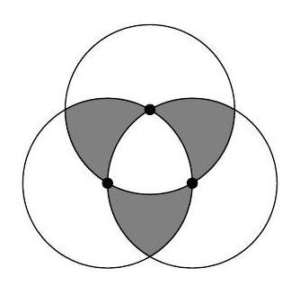

# AVP1187 — Single visual target

DynaMath:465 / MathVision:333 · different type · Domain and solution-set constraints

## Shared or similar visual information

A curved overlap region formed by intersecting circular outlines. On the left, use the tan lens labeled 79 inside both product-preference circles. On the right, use one of the gray curved components between the white central overlap and a pair of outer arcs.

## Evidence locations

- Left image: The tan lens labeled 79 inside both product-preference circles.
- Right image: One of the gray curved components between the white central overlap and a pair of outer arcs.

## Mathematical meanings

Left image: The lens represents customers who prefer both product categories. Right image: The gray components consist of locations inside exactly two of the three circles. The center common to all three is unshaded.

## Same mathematical meanings

no

## Rationales

The left lens encodes joint membership in two named sets. The right gray region selects pieces of a geometric area by circle coverage.

## Reasoning consequence

Correctly interpreting the markings means using 79 for the both-categories count on the left and excluding the white triple overlap when finding the shaded area on the right.

Only the selected target is annotated. AI visual-review draft; not independently double-annotated by humans.
