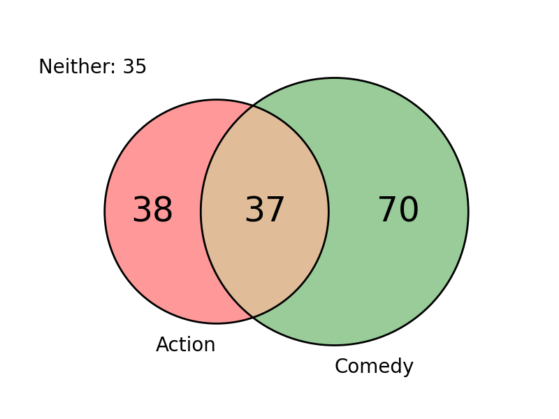
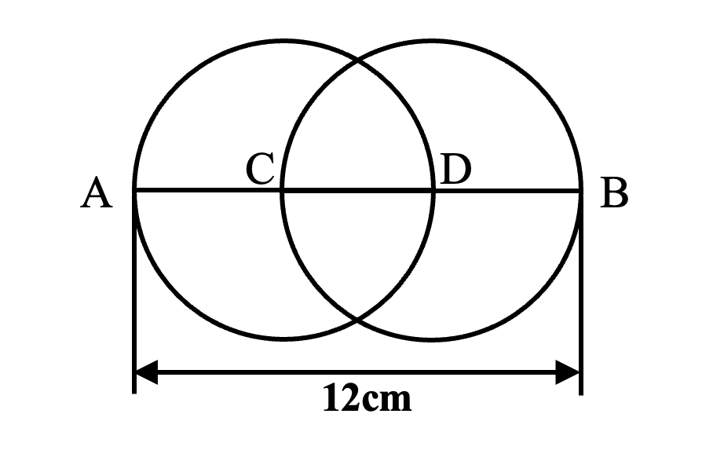

# AVP1189 — Single visual target

DynaMath:467 / We-Math:123 · different type · Domain and solution-set constraints

## Shared or similar visual information

A lens bounded by the arcs of two overlapping circles. On the left, use the tan lens labeled 37 between the Action and Comedy circles. On the right, use the unshaded lens between the two outer crescents of the equal-circle diagram.

## Evidence locations

- Left image: The tan lens labeled 37 between the Action and Comedy circles.
- Right image: The unshaded lens between the two outer crescents of the equal-circle diagram.

## Mathematical meanings

Left image: The lens represents moviegoers who like both genres. Right image: The lens is the geometric intersection of the two disks, crossing the line AB along CD.

## Same mathematical meanings

no

## Rationales

The left lens encodes simultaneous membership of the listed population or elements. The right lens represents a continuous geometric overlap between two disks.

## Reasoning consequence

Correctly interpreting the markings means using 37 for the count of people who like both genres on the left and subtracting the overlap length CD from AD + CB to obtain AB on the right.

Only the selected target is annotated. AI visual-review draft; not independently double-annotated by humans.
