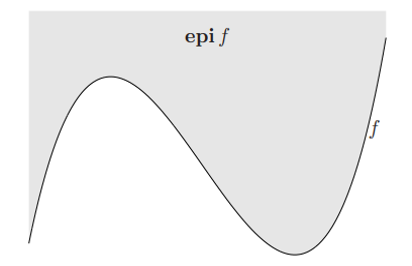
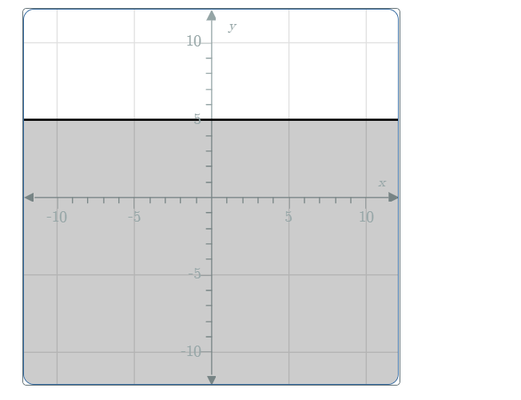

# AVP1191 — Single visual target

MathVista:235 / MathVerse:509 · same type · Domain and solution-set constraints

## Shared or similar visual information

A filled region selected by a comparison with a plotted boundary. On the left, use the gray region above the curve labeled f, with the visible text “epi f.” On the right, use the gray half-plane below the solid horizontal line.

## Evidence locations

- Left image: The gray region above the curve labeled f, with the visible text “epi f.”
- Right image: The gray half-plane below the solid horizontal line.

## Mathematical meanings

Left image: It represents the epigraph, the coordinate pairs on or above f. Right image: It consists of points satisfying the lower-side inequality, including equality along the solid line.

## Same mathematical meanings

yes

## Rationales

The shaded side identifies locations where the relevant comparison holds in each panel. The plotted boundary and its convention determine how equality is treated in each individual problem.

## Reasoning consequence

Correctly interpreting the markings means testing whether a point has ordinate at least f evaluated at its abscissa on the left and including points on the boundary and below it in the solution set on the right.

Only the selected target is annotated. AI visual-review draft; not independently double-annotated by humans.
