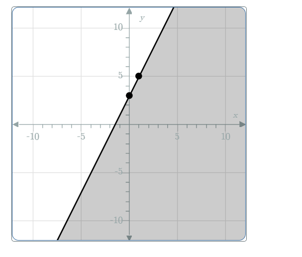

# AVP1194 — Single visual target

MathVerse:513 / MathVista:997 · same type · Domain and solution-set constraints

## Shared or similar visual information

A filled region selected by a comparison with a plotted boundary. On the left, use the gray half-plane below the rising solid line. On the right, use the hatched region below E and above the bottom of the curve labeled kx²/2.

## Evidence locations

- Left image: The gray half-plane below the rising solid line.
- Right image: The hatched region below E and above the bottom of the curve labeled kx²/2.

## Mathematical meanings

Left image: It marks the points satisfying the non-strict linear inequality, including its boundary. Right image: Its horizontal footprint identifies where kx²/2 is below E, with equality at the two crossings.

## Same mathematical meanings

yes

## Rationales

The shaded side identifies locations where the relevant comparison holds in each panel. The plotted boundary and its convention determine how equality is treated in each individual problem.

## Reasoning consequence

Correctly interpreting the markings means allowing points on the solid boundary as well as points on its shaded side on the left and using the two crossings to delimit the x-values at which kx²/2 is less than E on the right.

Only the selected target is annotated. AI visual-review draft; not independently double-annotated by humans.
