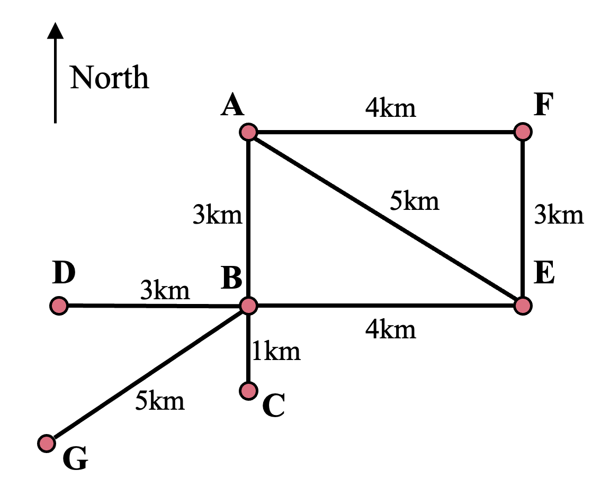

# AVP1194 — Single visual target

We-Math:411 / We-Math:406 · same type · Geometric markers

## Shared or similar visual information

An upward arrow on a straight vertical line.

## Evidence locations

- Left image: The arrow under North to the left of the route segments.
- Right image: The upward arrow beside North at the upper left.

## Mathematical meanings

Left image: The arrow gives compass north for the diagram. Right image: The arrow shows the north reference direction of the route diagram.

## Same mathematical meanings

yes

## Rationales

Both images use the mark in the same way: the arrow sets the compass-north reference for the geometry.

Only the selected target is annotated. AI visual-review draft; not independently double-annotated by humans.
