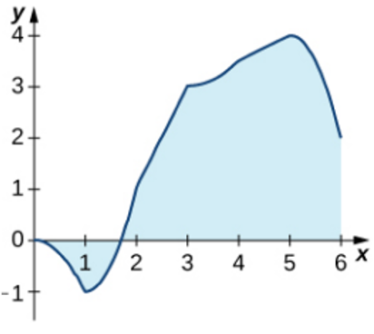

# AVP1196 — Single visual target

DynaMath:64 / MathVista:260 · same type · Domain and solution-set constraints

## Shared or similar visual information

A shaded area extending from the x-axis to a function graph over a selected x-interval. On the left, use the gray area above the x-axis between the two branches of the parabola. On the right, use the larger blue region above the x-axis from the positive crossing to the right edge at x = 6.

## Evidence locations

- Left image: The gray area above the x-axis between the two branches of the parabola.
- Right image: The larger blue region above the x-axis from the positive crossing to the right edge at x = 6.

## Mathematical meanings

Left image: The shading selects the bounded region between the parabola and the x-axis from x = −5 to x = 5, whose top extends beyond the window. Right image: It selects the portion of the area measured between the upper curve and the x-axis over the indicated interval.

## Same mathematical meanings

yes

## Rationales

The graph and axis determine the vertical extent of the area, while the edges of the shaded patch determine the horizontal interval.

## Reasoning consequence

Correctly interpreting the markings means using the two zeros as the area bounds and including the portion cut off by the window on the left and using x = 6 as the right bound and separating the above-axis patch from the negative lobe on the right.

Only the selected target is annotated. AI visual-review draft; not independently double-annotated by humans.
