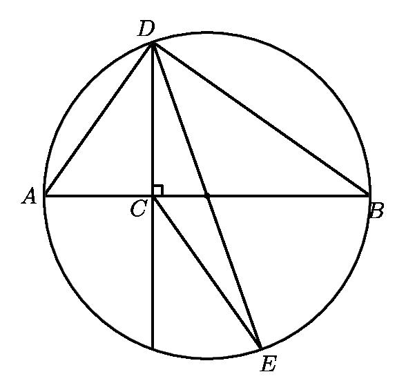
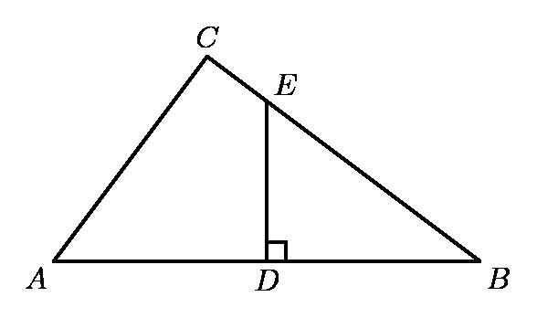

# AVP1197 — Single visual target

MathVision:2147 / MathVision:2257 · same type · Geometric markers

## Shared or similar visual information

A right-angle square.

## Evidence locations

- Left image: The square at C where the horizontal chord meets the vertical segment.
- Right image: The square at D beside the segment ED.

## Mathematical meanings

Left image: The horizontal chord AB is perpendicular to the vertical line through C and D. Right image: ED is perpendicular to AB.

## Same mathematical meanings

yes

## Rationales

Both images use the mark in the same way: a square placed in the angle between two segments marks those segments as perpendicular.

Only the selected target is annotated. AI visual-review draft; not independently double-annotated by humans.
