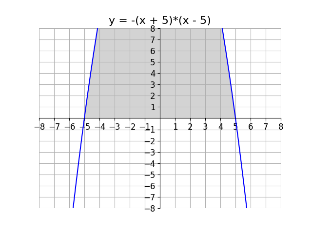

# AVP1197 — Single visual target

DynaMath:64 / MathVista:671 · same type · Domain and solution-set constraints

## Shared or similar visual information

A shaded area extending from the x-axis to a function graph over a selected x-interval. On the left, use the gray area above the x-axis between the two branches of the parabola. On the right, use the blue-green fill under the right branch of the semicircle, to the right of x = 3.

## Evidence locations

- Left image: The gray area above the x-axis between the two branches of the parabola.
- Right image: The blue-green fill under the right branch of the semicircle, to the right of x = 3.

## Mathematical meanings

Left image: The shading selects the bounded region between the parabola and the x-axis from x = −5 to x = 5, whose top extends beyond the window. Right image: It selects the region under the arch only from x = 3 to x = 6.

## Same mathematical meanings

yes

## Rationales

The graph and axis determine the vertical extent of the area, while the edges of the shaded patch determine the horizontal interval.

## Reasoning consequence

Correctly interpreting the markings means using the two zeros as the area bounds and including the portion cut off by the window on the left and using the restricted upper interval from 3 to 6 for the shaded area on the right.

Only the selected target is annotated. AI visual-review draft; not independently double-annotated by humans.
