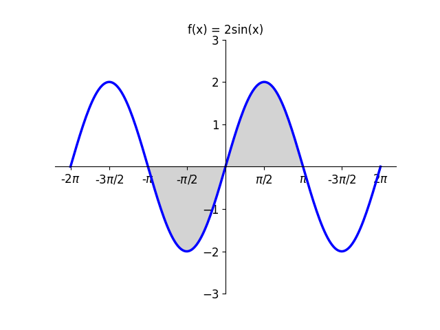
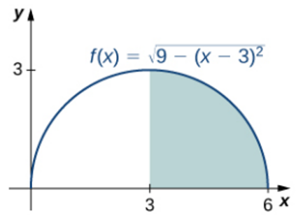

# AVP1198 — Single visual target

DynaMath:77 / MathVista:671 · same type · Domain and solution-set constraints

## Shared or similar visual information

A shaded area extending from the x-axis to a function graph over a selected x-interval. On the left, use the gray positive lobe between the sine curve and the x-axis from 0 to π. On the right, use the blue-green fill under the right branch of the semicircle, to the right of x = 3.

## Evidence locations

- Left image: The gray positive lobe between the sine curve and the x-axis from 0 to π.
- Right image: The blue-green fill under the right branch of the semicircle, to the right of x = 3.

## Mathematical meanings

Left image: It selects the area bounded by the upper sine lobe and the horizontal axis. Right image: It selects the region under the arch only from x = 3 to x = 6.

## Same mathematical meanings

yes

## Rationales

The graph and axis determine the vertical extent of the area, while the edges of the shaded patch determine the horizontal interval.

## Reasoning consequence

Correctly interpreting the markings means integrating over the positive lobe from 0 to π when calculating that part of the area on the left and using the restricted upper interval from 3 to 6 for the shaded area on the right.

Only the selected target is annotated. AI visual-review draft; not independently double-annotated by humans.
